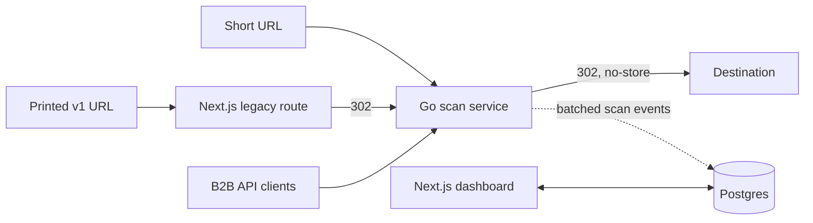

# VisionLink QR

Permanent QR code hosting for VisionLink: every scan of a code printed on a business card or vehicle goes through it, and companies manage their codes from a dashboard or a B2B API.

## My role

Lead developer and the only engineer on the rebuild. I designed and built the Go scan service, the database and the dashboard, and ran the cutover from v1. VisionLink's co-founder handled planning and the business side.

## Stack

Go with Fiber and pgx, Next.js 16, React 19, TypeScript, Tailwind CSS 4, TanStack Query, zod, Supabase (Postgres with row-level security, Auth), pgTAP, GitHub Actions. The scan service runs on Railway and the dashboard on Vercel.

## Architecture

The Go service is the only place a code is resolved or a scan recorded. It always answers with a 302 and no-store, never a 301, so a destination can change after printing. The dashboard reads through row-level security and writes through database functions, with pgTAP tests in CI.

## Hard problems

**Printed codes can't be recalled.** v1 URLs are printed on metal cards and vehicles, so they have to work forever. I rejected porting v1's redirect, create and stats endpoints into v2, because that would carry over v1's quirks and split code lookup across two services. Instead a thin legacy route forwards every printed URL to the Go service. Before the swap I audited every v1 code against the new code rules and followed each printed URL through both hops. Every printed code resolved at cutover.

**A scan must never fail.** I rejected rate-limiting scans with a 429 the way the API is limited, because the person scanning has no retry button. Scan analytics go into a bounded in-memory queue that writes in batches, so a slow database never holds up a redirect. When the queue is full or one source floods it, the analytics event is dropped and the scan still redirects.

## Status

Live. Production moved to v2 in September 2026. p95 redirect latency dropped from about 4 s to 312 ms.

Source is private. Full write-up: https://mathysbasson.vercel.app/work/visionlink-qr-v2
